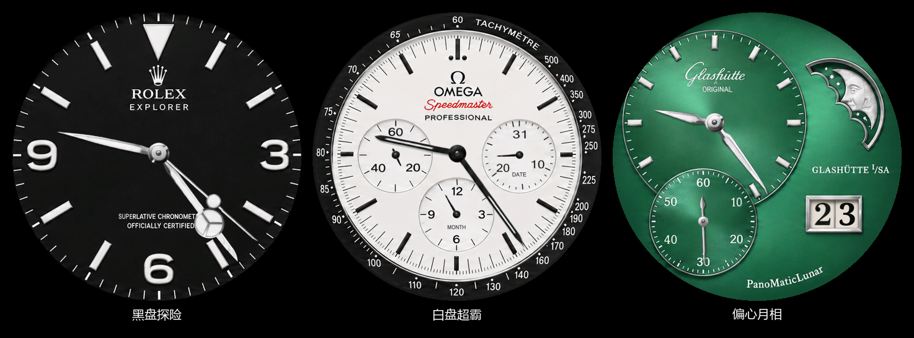

# 微雪 1.75C 圆屏桌面天气钟

运行在 **Waveshare ESP32-S3-Touch-AMOLED-1.75C** 上的独立天气钟。开发板通过 2.4 GHz Wi-Fi 获取成都天气，用 NTP 校时。配网完成后可以脱离电脑使用。当前正式固件版本日期为 **2026-11-23**。

[下载正式固件（应用镜像）](https://github.com/liuyu3049-web/waveshare-175c-weather-clock/releases/download/v2026.11.23/weather_clock_175c.ino.bin) · [SHA-256 校验](firmware/SHA256SUMS) · [编译与刷写说明](docs/build.md) · [原理图、引脚和分区](docs/hardware.md)

## 表盘和天气

首页可以切换山景数字、山景指针、复古翻页、孔雀蓝、黑盘探险、白盘超霸和偏心月相七款表盘。白盘的左侧小盘走秒，底部指示月份，右侧指示日期。后三款以时间和日历为主，天气仍可通过滑动查看。

天气由 Open-Meteo 提供。固件使用成都坐标（北纬 30.67°、东经 104.07°）和北京时间（UTC+8）。联网后每 15 分钟更新，除当前天气外，还显示 6 个小时的逐时预报和 5 天的逐日预报。[Open-Meteo 天气接口](https://open-meteo.com/en/docs)

## 第一次配网

1. 初次启动时，屏幕会显示配网热点和本次生成的 8 位密码。以后要添加或管理网络，在首页长按约 1.5 秒，进入设置，点“手机配网”。
2. 手机连接屏幕上显示的热点，在浏览器打开 `http://192.168.4.1`。
3. 输入目标 2.4 GHz Wi-Fi 的名称和密码，连接并保存。可以用“仅保存”提前录入其他地点的网络，也可以在页面上忘记已保存的网络。

开发板最多保存 16 个网络。到新地点后，它会扫描附近已保存的网络，并优先尝试信号较强的网络。

## 日常操作

| 操作 | 结果 |
| --- | --- |
| 双击首页 | 切换到下一款表盘 |
| 左右滑动 | 在首页、逐时预报和逐日预报之间切换 |
| 长按首页约 1.5 秒 | 打开设置，可调五档亮度、手机配网和自动息屏时间 |
| 设置自动息屏 | 可选 15 秒、30 秒、1 分钟、2 分钟、5 分钟或常亮 |
| 短按 POWER | 息屏或亮屏。息屏后先保持联网和天气更新，持续息屏 5 分钟后进入深睡并暂停更新 |
| 从深睡亮屏 | 已经校准过的设备先在离线状态恢复本地时间并绘制首页，随后联网刷新天气 |
| 长按 POWER 约 3 秒 | 显示关机确认页，可选择取消或关机 |

## 硬件与官方资料

本项目适配型号后缀为 **1.75C** 的圆屏板。它采用 ESP32-S3R8、8 MB PSRAM、1.75 英寸 466 × 466 AMOLED、CO5300 显示驱动（QSPI）、CST9217 触控（I²C）和 AXP2101 电源管理芯片。微雪型号页标注 16 MB Flash，本项目测试样机读取得到 32 MB。刷写前请按实际设备核对芯片、Flash 和分区表。[微雪硬件说明](https://docs.waveshare.com/ESP32-S3-Touch-AMOLED-1.75C) · [原理图与资源](https://docs.waveshare.com/ESP32-S3-Touch-AMOLED-1.75C/Resources-And-Documents) · [微雪示例与出厂固件](https://github.com/waveshareteam/ESP32-S3-Touch-AMOLED-1.75C)

## 验证记录

- 2026-11-23 正式版已在样机上运行，核对了联网、天气更新、小时与逐日页面、三款新表盘的实板画面。三款表盘秒针的短时实测刷新率均约 30 帧/秒。
- 使用相同走时代码的测试版做了 5 分钟真实深睡。定时唤醒时保持 Wi-Fi 关闭，首屏直接显示本地时间。与电脑测得的经过时间相比，设备慢约 0.61 秒。整夜走时误差和一天的整机耗电仍待实测。
- 排查隔夜走时时，可用 115200 波特率打开 USB 串口，在唤醒并完成网络校时后发送 `rtc`。`ntp_error_ms` 表示首次网络时间减去离线估计时间的毫秒数，正值表示离线时钟偏慢。

工程使用的 Noto Sans SC 与 Noto Serif Bold 字形及字体许可见 [FONT-LICENSE.txt](FONT-LICENSE.txt)。三个仿机械表盘来自本项目的设计参考，保留了参考盘面的品牌标识。
